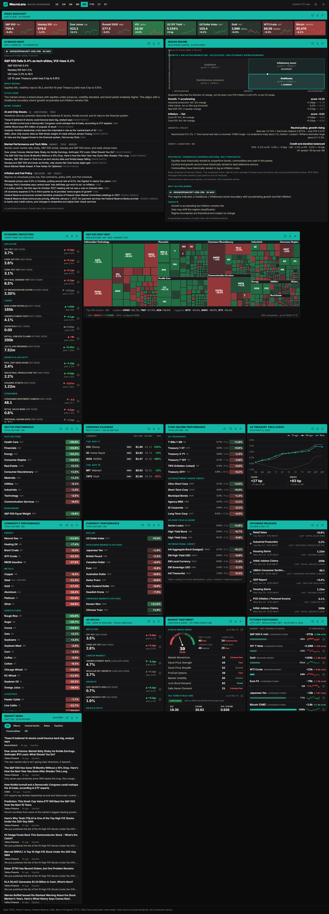
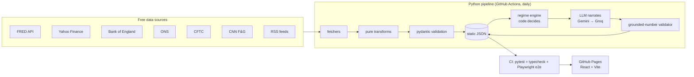

# MacroLens

**A self-updating macro dashboard that brings markets, the economy, rates, positioning and news into one place, built AI-first with Claude Code.**

**Live:** https://bmxmiller.github.io/macro_dashboard/ · updates every weekday after the US close · **£0 to run** (free data, free hosting, free-tier LLMs)



<sub>Light theme: [screenshot](docs/images/dashboard-light.png) · Mobile: [screenshot](docs/images/dashboard-mobile-dark.png)</sub>

---

## Why
Macro data is scattered across FRED, the BLS, the Fed, the Bank of England, the CFTC and dozens of news sites. MacroLens puts it on one screen, with **an explanation behind every number**: each metric has an ⓘ card covering *what it is*, *why it matters* and *how to read it*, plus a link to its official source. The goal is to make trends readable enough to build an investment thesis on.

## What's on the dashboard
| Area | Panels |
|---|---|
| **Overview** | Index snapshot (S&P, Nasdaq, Dow, Russell, VIX, 10Y, DXY, gold, oil, BTC) with sparklines |
| **AI insights** *(rolling out)* | AI macro brief and news clusters; Macro Regime (growth × inflation quadrant, policy stance, credit vs duration) |
| **US macro** | 22 indicators (inflation, labour, growth, consumer, policy, debt), each with full history and NBER recession shading · upcoming releases + FOMC calendar |
| **UK macro** | CPI, core CPI, unemployment, pay growth, GDP, Bank Rate, gilts (ONS + Bank of England) |
| **Equities** | GICS sector performance · earnings calendar (top 64 S&P names, EPS estimate vs prior year) |
| **Rates & credit** | Fixed income total returns with yield and duration · Treasury yield curve vs 1M/1Y ago, 2s10s and 3m10y |
| **Commodities & FX** | 30 futures across energy, metals, ags and livestock · 16 currencies vs USD |
| **Sentiment & positioning** | CNN Fear & Greed + 7 components · VIX term structure · CFTC Commitments of Traders with 3-year percentiles |
| **News** | 13 official and financial RSS feeds, de-duplicated and tagged by asset class |

Interactive: one global timeframe (1D → 3Y) for every performance panel, click any metric for its full history, dark/light themes, a custom accent colour, a colour-blind-safe gain/loss palette, show/hide panels, and PNG export of any panel.

## Architecture


- **Static by design:** no server and no exposed keys. The browser only reads JSON that the pipeline publishes.
- **Fault-isolated sections:** if one source fails, the last good data is kept and that panel shows a *Stale* badge. API keys are redacted from every error message, which matters because `meta.json` is public.
- **Registry-driven:** every metric and ticker lives in YAML (`pipeline/registry/`), About text included. Adding a metric means adding data, not code.
- **Bad data never ships:** data commits trigger the full CI suite, including browser tests, and deploy only runs after CI passes.

## AI features: "code decides, the LLM narrates"
- The **macro regime is computed deterministically** from published data and unit-tested: growth and inflation momentum, the real policy rate, and credit vs duration-matched Treasuries.
- A free-tier LLM writes the daily brief and news summaries. A **number checker** requires each number it writes to match the input data's value, unit, direction and metric name. For example, "Core CPI rose to 3.7%" is rejected because 3.7% is *headline* CPI.
- **It is a safety net, not a guarantee.** A 25-string adversarial suite cut bypasses from 22/25 to 0/25, but a much broader red-team (about 520 strings, written by a separate red-team agent) still found many ways through: appositive sentences ("Core CPI, now at 3.7%, rose"), reversed "from X to Y", odd number formatting, softer advice wording and invented causes. A checker with no world model cannot catch invented causes at all. The findings are tracked in [issue #16](https://github.com/bmxmiller/macro_dashboard/issues/16), and the panel is always labelled AI-generated.
- Semantic guards catch common advice words and claims that contradict the computed regime (the red-team found softer phrasings they miss). Outputs show the model, timestamp and a "not investment advice" disclaimer.

## Built AI-first with Claude Code
This project is also a case study in **agentic software engineering**. The full log, including incidents and fixes, is in **[docs/AI_WORKFLOW.md](docs/AI_WORKFLOW.md)**.

- **Plan mode first:** a requirements interview, then an approved plan before any code was written.
- **Parallel subagents:** shared contracts first (schemas, panel shell, file ownership), then up to 3 background agents in **isolated git worktrees**, each delivering a **pull request**.
- **Review before merge:** each PR gets `/code-review` (inline PR comments) and a custom **`finance-reviewer`** agent that checks the numbers and the economics. Findings are relayed back to the authoring agent and fixed with regression tests.
- **Guardrails enforced by the harness:** a post-edit **hook** runs pytest/tsc after every change and feeds failures straight back to the agent. It caught broken intermediate states several times.
- **Reusable tooling:**
  - **Skill:** `/add-metric`
  - **Custom agents:** `finance-reviewer`, `data-verifier`
  - **Project memory:** `CLAUDE.md`
- **External validation:** the published numbers were cross-checked against an independent macro dashboard and official sources.

Real problems the agents hit and solved:
- FRED stalling browser-like requests
- the BoE having no 2-year gilt series, so it's derived from yield-curve spreadsheets
- ONS publishing 3-month labour data under the middle month
- an LLM quoting an ETF *price* as an *index level*
- the harness's worktree isolation failing on a Windows path quirk

## Tech stack
**Pipeline:** Python 3.13, pandas, pydantic, yfinance, feedparser · **Web:** React 19, TypeScript, Vite, Tailwind v4, ECharts (lazy-loaded), Zustand · **Quality:** pytest (offline), Playwright e2e plus screenshot artifacts · **Ops:** GitHub Actions (CI, scheduled data, Pages deploy), a branch ruleset with a deploy-key bypass for data commits · **AI:** Gemini and Groq free tiers, called from CI only.

## Run it locally
```bash
python -m venv .venv && ./.venv/Scripts/pip install -r pipeline/requirements.txt   # macOS/Linux: .venv/bin/pip
cp .env.example .env                       # add a free FRED key (AI keys optional)
./.venv/Scripts/python -m pipeline.build   # fetch + build all sections
cd web && npm install && npm run dev       # http://localhost:5173
```
Tests: `python -m pytest` · `cd web && npm run typecheck && npm run test:e2e`. Full setup, including GitHub secrets and Pages, is in **[docs/SETUP.md](docs/SETUP.md)**.

## Data sources & disclaimer
FRED (St. Louis Fed), BLS, BEA, Federal Reserve, Bank of England, ONS, CFTC, Yahoo Finance, CNN, Cboe and public RSS feeds. Performance figures are total returns (dividends reinvested). **For education and research only. Not investment advice.**
